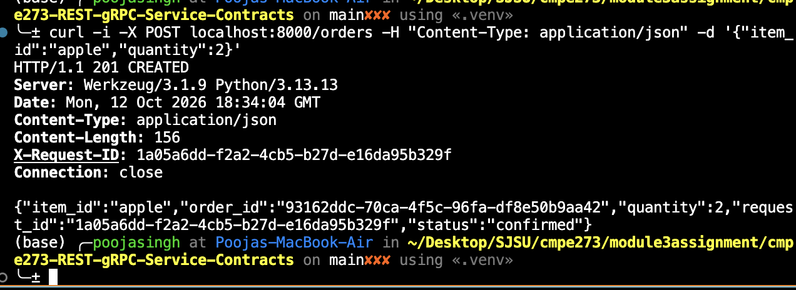
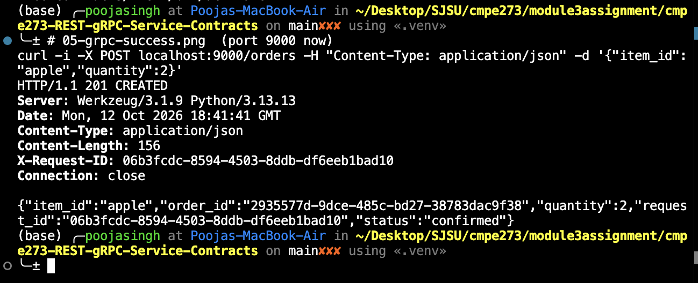
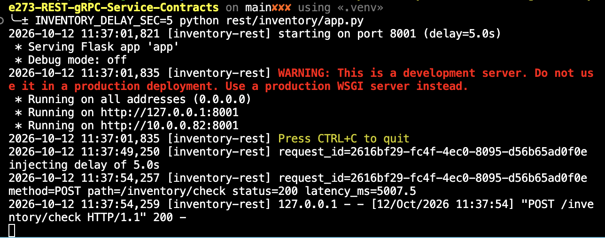
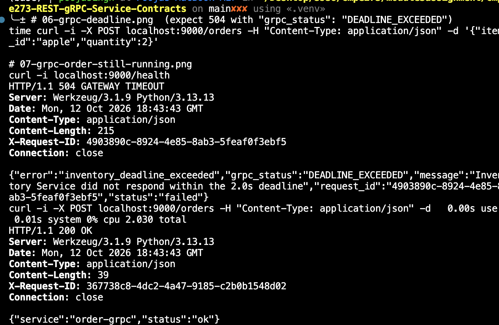
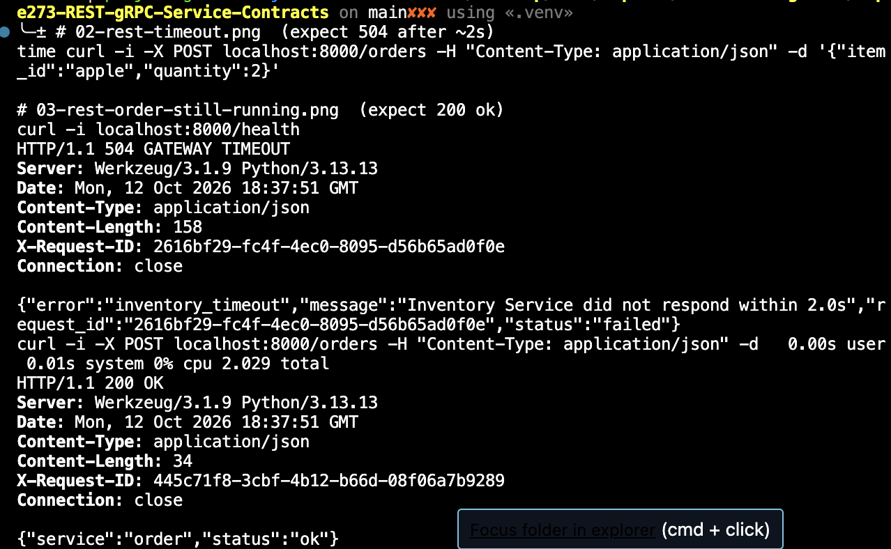

# CMPE 273 – REST vs gRPC Service Contracts

Two services, implemented twice: once with **REST/JSON** and once with **gRPC**.

- **Order Service**: accepts an order containing an `item_id` and a `quantity`.
- **Inventory Service**: checks whether the requested item and quantity are available.

Both versions offer the same functionality. Clients always place orders over HTTP/JSON (`POST /orders`). The two versions differ only in how the **Order → Inventory** call is made.

```
                 REST version                                gRPC version
client ──HTTP──► Order :8000 ──REST/JSON──► Inventory :8001     client ──HTTP──► Order :9000 ──gRPC──► Inventory :50051
                       (2s read timeout)                                              (2s deadline)
```

Language: Python 3.13 (Flask, requests, grpcio)

---

## Project structure

```
.
├── rest/
│   ├── inventory/app.py        # REST Inventory: POST /inventory/check
│   └── order/app.py            # REST Order: POST /orders, calls Inventory with a timeout
├── grpc/
│   ├── proto/
│   │   ├── inventory.proto     # service contract
│   │   ├── inventory_pb2.py        # generated from the .proto
│   │   └── inventory_pb2_grpc.py   # generated from the .proto
│   ├── inventory/server.py     # gRPC Inventory: CheckAvailability RPC
│   └── order/app.py            # Order: POST /orders, calls Inventory over gRPC with a deadline
├── screenshots/
├── requirements.txt
└── README.md
```

Stock data is held in memory and is the same in both versions:

| item_id  | in stock |
|----------|----------|
| apple    | 10       |
| notebook | 5        |
| pen      | 0        |

---

## Setup (one time)

```bash
python3 -m venv .venv
source .venv/bin/activate
pip install -r requirements.txt

# Regenerate gRPC code (only needed if inventory.proto changes; generated files are committed)
python -m grpc_tools.protoc -I grpc/proto --python_out=grpc/proto --grpc_python_out=grpc/proto grpc/proto/inventory.proto
```

Run `source .venv/bin/activate` in every new terminal tab.

---

## Running the REST version

```bash
# Terminal 1 – Inventory (port 8001)
python rest/inventory/app.py

# Terminal 2 – Order (port 8000)
python rest/order/app.py

# Terminal 3 – place an order
curl -i -X POST localhost:8000/orders -H "Content-Type: application/json" \
  -d '{"item_id":"apple","quantity":2}'
```

**REST contract**

| Endpoint | Request | Responses |
|---|---|---|
| `POST /inventory/check` | `{"item_id": str, "quantity": int}` | `200` available · `404` item not found · `409` insufficient stock · `400` invalid request |
| `POST /orders` | `{"item_id": str, "quantity": int}` | `201` confirmed · `404` · `409` · `400` · `504` Inventory timed out · `503` Inventory unreachable |
| `GET /health` | none | `200` |

The Order → Inventory call uses `requests` with `timeout=(1s connect, 2s read)`.

## Running the gRPC version

```bash
# Terminal 1 – Inventory gRPC server (port 50051)
python grpc/inventory/server.py

# Terminal 2 – Order (port 9000)
python grpc/order/app.py

# Terminal 3 – place an order
curl -i -X POST localhost:9000/orders -H "Content-Type: application/json" \
  -d '{"item_id":"apple","quantity":2}'
```

**gRPC contract** (`grpc/proto/inventory.proto`)

```proto
service Inventory {
  rpc CheckAvailability (CheckRequest) returns (CheckResponse);
}
message CheckRequest  { string item_id = 1; int32 quantity = 2; }
message CheckResponse { bool available = 1; string item_id = 2; int32 requested = 3; int32 in_stock = 4; }
```

| Situation | gRPC status from Inventory | HTTP status returned by Order |
|---|---|---|
| Available | `OK` | `201` |
| Item does not exist | `NOT_FOUND` | `404` |
| Not enough stock | `FAILED_PRECONDITION` | `409` |
| Bad input | `INVALID_ARGUMENT` | `400` |
| Inventory too slow | `DEADLINE_EXCEEDED` | `504` |
| Inventory down | `UNAVAILABLE` | `503` |

The Order → Inventory call sets a 2-second deadline: `stub.CheckAvailability(req, timeout=2)`.

### Configuration

| Env var | Default | Used by |
|---|---|---|
| `INVENTORY_DELAY_SEC` | `0` | both Inventory services (injected slowness) |
| `READ_TIMEOUT_SEC` / `CONNECT_TIMEOUT_SEC` | `2` / `1` | REST Order |
| `GRPC_DEADLINE_SEC` | `2` | gRPC Order |
| `ORDER_PORT`, `INVENTORY_PORT`, `INVENTORY_GRPC_PORT` | `8000`/`9000`, `8001`, `50051` | ports |

---

## Results

### 1. Successful REST request and response

```
$ curl -i -X POST localhost:8000/orders -H "Content-Type: application/json" -d '{"item_id":"apple","quantity":2}'
HTTP/1.1 201 CREATED
Content-Type: application/json
X-Request-ID: 1a05a6dd-f2a2-4cb5-b27d-e16da95b329f

{"item_id":"apple","order_id":"93162ddc-70ca-4f5c-96fa-df8e50b9aa42","quantity":2,
 "request_id":"1a05a6dd-f2a2-4cb5-b27d-e16da95b329f","status":"confirmed"}
```

Inventory log for the same request (same request ID, propagated via the `X-Request-ID` header):

```
[inventory-rest] request_id=1a05a6dd-f2a2-4cb5-b27d-e16da95b329f method=POST path=/inventory/check status=200 latency_ms=0.7
```



### 2. Successful gRPC request and response

```
$ curl -i -X POST localhost:9000/orders -H "Content-Type: application/json" -d '{"item_id":"apple","quantity":2}'
HTTP/1.1 201 CREATED
Content-Type: application/json
X-Request-ID: 06b3fcdc-8594-4503-8ddb-df6eeb1bad10

{"item_id":"apple","order_id":"2935577d-9dce-485c-bd27-38783dac9f38","quantity":2,
 "request_id":"06b3fcdc-8594-4503-8ddb-df6eeb1bad10","status":"confirmed"}
```

Inventory gRPC server log (request ID propagated via gRPC metadata):

```
[inventory-grpc] request_id=06b3fcdc-8594-4503-8ddb-df6eeb1bad10 rpc=CheckAvailability item_id=apple quantity=2 status=OK latency_ms=0.0
```



---

## Failure handling: Inventory responds too slowly

Inventory was restarted with a 5-second delay, which is longer than both the 2-second REST timeout and the 2-second gRPC deadline:

```bash
INVENTORY_DELAY_SEC=5 python rest/inventory/app.py      # REST
INVENTORY_DELAY_SEC=5 python grpc/inventory/server.py   # gRPC
```

### 3. REST timeout handling

```
$ time curl -i -X POST localhost:8000/orders -H "Content-Type: application/json" -d '{"item_id":"apple","quantity":2}'
HTTP/1.1 504 GATEWAY TIMEOUT
X-Request-ID: 2616bf29-fc4f-4ec0-8095-d56b65ad0f0e

{"error":"inventory_timeout","message":"Inventory Service did not respond within 2.0s",
 "request_id":"2616bf29-fc4f-4ec0-8095-d56b65ad0f0e","status":"failed"}

0.00s user 0.01s system 0% cpu 2.029 total
```

Order gave up after **2.03 s** and returned a clean `504` JSON error instead of hanging for 5 s or crashing.
The Inventory log shows it kept working for the full 5 s, unaware that the caller had already left:

```
[inventory-rest] request_id=2616bf29-... injecting delay of 5.0s
[inventory-rest] request_id=2616bf29-... method=POST path=/inventory/check status=200 latency_ms=5007.5
```




### 4. gRPC deadline handling

```
$ time curl -i -X POST localhost:9000/orders -H "Content-Type: application/json" -d '{"item_id":"apple","quantity":2}'
HTTP/1.1 504 GATEWAY TIMEOUT
X-Request-ID: 4903890c-8924-4e85-8ab3-5feaf0f3ebf5

{"error":"inventory_deadline_exceeded","grpc_status":"DEADLINE_EXCEEDED",
 "message":"Inventory Service did not respond within the 2.0s deadline",
 "request_id":"4903890c-8924-4e85-8ab3-5feaf0f3ebf5","status":"failed"}

0.00s user 0.01s system 0% cpu 2.030 total
```

The gRPC call failed with `DEADLINE_EXCEEDED` after **2.03 s**, and Order translated it into a clean `504`.



### 5. Order Service remains running after the failures

Immediately after each failed order, the Order Service still answers:

```
$ curl -i localhost:8000/health
HTTP/1.1 200 OK
{"service":"order","status":"ok"}

$ curl -i localhost:9000/health
HTTP/1.1 200 OK
{"service":"order-grpc","status":"ok"}
```

The slow dependency produced a fast, well-formed error for that one request. The Order process itself was unaffected and kept serving traffic.




---

## REST vs gRPC: what was different

In the REST version the contract only existed implicitly in the code: both services had to agree on JSON field names and types by convention, and each one validated the payload by hand. In the gRPC version, `inventory.proto` was the single source of truth, and the generated stubs gave typed request and response objects, so a mismatched field would fail at code-generation or call time instead of silently at runtime. Error handling also felt different: REST overloads HTTP status codes (`404`, `409`) whose meaning we had to choose, while gRPC has a fixed set of status codes (`NOT_FOUND`, `FAILED_PRECONDITION`, `DEADLINE_EXCEEDED`) that the client can switch on directly. Both failure mechanisms stopped waiting at about 2.03 s, but a REST timeout is purely a client-side setting, whereas a gRPC deadline is sent with the request, so the server can see how much time remains; in our REST run, Inventory kept working for the full 5 s after Order had already given up. The trade-off is tooling: REST could be tested with plain `curl` and needed no build step, while gRPC required `protoc` code generation and a dedicated client (or `grpcurl`) to call the service directly.
